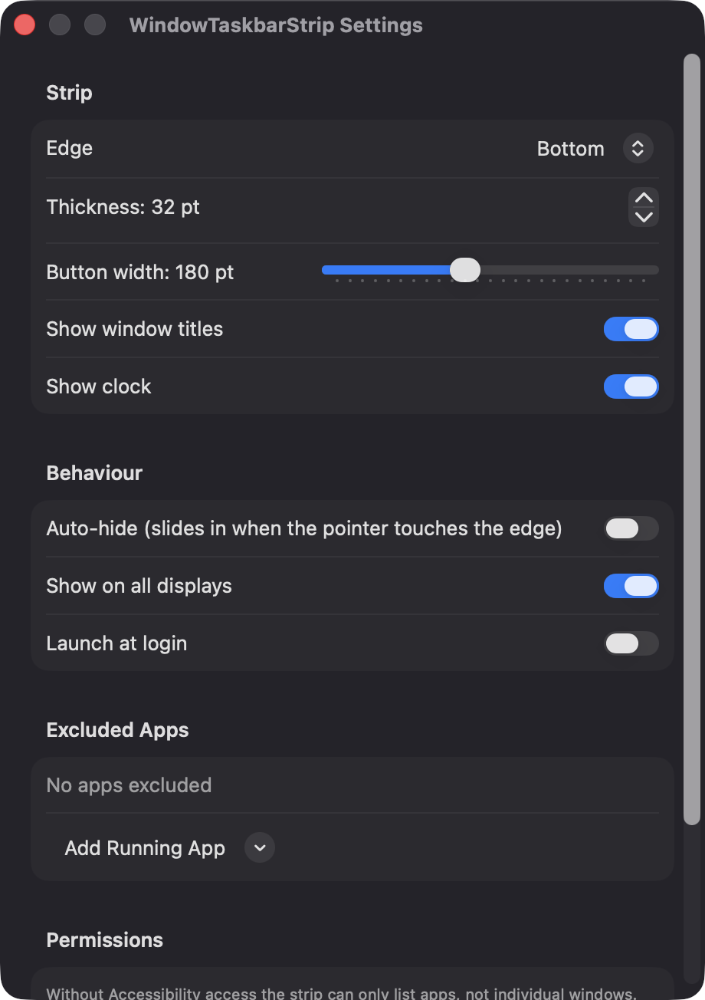
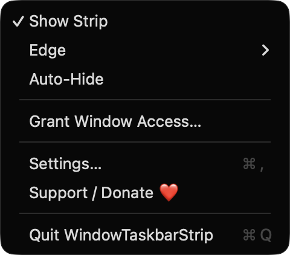

# WindowTaskbarStrip

**🌐 Website:** [turhe123.github.io/window-taskbar-strip](https://turhe123.github.io/window-taskbar-strip/)

A slim always-visible taskbar strip listing every open window as a button you click to raise or minimize.

> 🆓 A free, open-source **uBar alternative** for macOS 14+. Native Swift, no accounts, no subscriptions, MIT licensed.


## Why

WindowTaskbarStrip is a free, open-source, 100% native, backend-free alternative to paid utilities in the *Window Management* category. It was inspired by uBar ($30 one-time), which showed how useful it is to see every window title at a glance. This is a lighter take: it sits at a screen edge alongside your Dock instead of replacing it, makes no network connections, and has no accounts or telemetry.

## Features

- **One button per window**, showing the app icon and the window title (truncated to a configurable width), grouped by app with dividers between groups.
- **Click to raise, click again to minimize.** Clicking the frontmost window's button minimizes it; clicking a minimized window restores and raises it.
- **Visual state:** the frontmost window is highlighted with the accent color, and minimized or hidden windows are dimmed.
- **Context menu** on every button: Raise/Minimize, Close Window, and Quit App. **Middle-click** a button to close its window.
- **Any edge:** dock the strip at the bottom, top, left or right. Vertical edges show icon-only buttons.
- **Multiple displays:** one strip per screen, or only the primary screen. Strips are rebuilt when the display layout changes.
- **Auto-hide:** optionally slide the strip in when the pointer touches its screen edge.
- **Stays out of the way:** positioned inside the screen's visible frame (below the menu bar, beside the Dock), follows you across Spaces, never takes keyboard focus, and hides itself while a full-screen window covers the display.
- **Overflow handling:** when there are too many windows, the strip scrolls with faded edges.
- **Optional clock** at the end of the strip, and a faint "Nothing open" label when there are no windows.
- **Hung-app feedback:** if an app doesn't respond to a raise request, its button shakes instead of blocking the strip.
- **Settings:** edge, thickness (24–64 pt), button width (80–320 pt), show titles, show clock, auto-hide, show on all displays, launch at login, and a list of excluded apps.
- **Menu bar item** to toggle the strip, change edge, toggle auto-hide, open Settings, and quit. The app has no Dock icon.
- **Graceful fallback:** without Accessibility access, the strip lists running apps (one button each) instead of individual windows.
- **Responsive:** updates instantly via Accessibility observers and workspace notifications, with a 0.5 s refresh as a fallback.

## Screenshots

<p align="center"></p>

<p align="center"><em>The taskbar strip docked at the bottom of the screen, with one button per app, a permission shortcut, and a clock.</em></p>

<p align="center"></p>

<p align="center"><em>Settings for the strip&#x27;s edge, thickness, button width, titles, clock, auto-hide, multiple displays, launch at login, and excluded apps.</em></p>

<p align="center"></p>

<p align="center"><em>The menu bar item: show or hide the strip, change its edge, toggle auto-hide, open Settings, or donate.</em></p>

<p align="center"></p>

<p align="center"><em>Docked on the left edge, the strip switches to icon-only buttons and highlights the frontmost app.</em></p>

## Install

1. Download `WindowTaskbarStrip-macOS.zip` from the [latest release](https://github.com/turhe123/window-taskbar-strip/releases/latest).
2. Unzip it and move `WindowTaskbarStrip.app` to `/Applications`.
3. Because the app is open source and not notarized, clear the quarantine attribute:

   ```bash
   xattr -cr /Applications/WindowTaskbarStrip.app
   ```

4. Right-click the app and choose **Open** the first time you launch it.

Requires macOS 14.0 or later.

## Build from source

You need Xcode with the macOS SDK and [XcodeGen](https://github.com/yonaskolb/XcodeGen).

```bash
brew install xcodegen
xcodegen generate
xcodebuild -project WindowTaskbarStrip.xcodeproj -scheme WindowTaskbarStrip -configuration Release -derivedDataPath ./build build
```

The app is produced at `build/Build/Products/Release/WindowTaskbarStrip.app`.

## Permissions

- **Accessibility** (the only permission the app asks for). It is used to read each app's window list, titles, minimized and full-screen state, and to raise, minimize and close windows. You can grant it from the strip's "Grant window access" button, the menu bar item, or Settings. Without it, the app still runs but only lists and activates/hides whole apps.
- **Launch at login** is optional and uses the system login-item API (`SMAppService`); no extra permission prompt is involved.

The app does **not** request Screen Recording, Microphone, Camera, or network access, and the code does not use them.

## Support ❤️

If WindowTaskbarStrip is useful to you, you can support its development:

[Support Or (Leo) Davidai ❤️](https://ko-fi.com/leodavidai)

The app also has a "Support / Donate ❤️" button in its menu and Settings.

## More free Mac apps

WindowTaskbarStrip is one of [60 free, open-source Mac utilities](https://github.com/turhe123/mac-apps) built the same way: native Swift, no accounts, no telemetry. Browse the full gallery at [turhe123.github.io/mac-apps](https://turhe123.github.io/mac-apps/).

## License

MIT © Or Davidai Bachar
